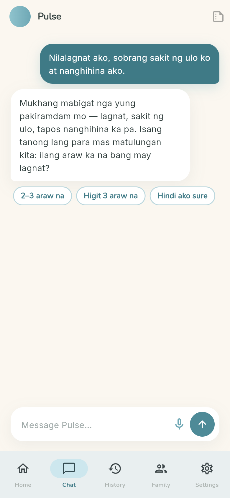
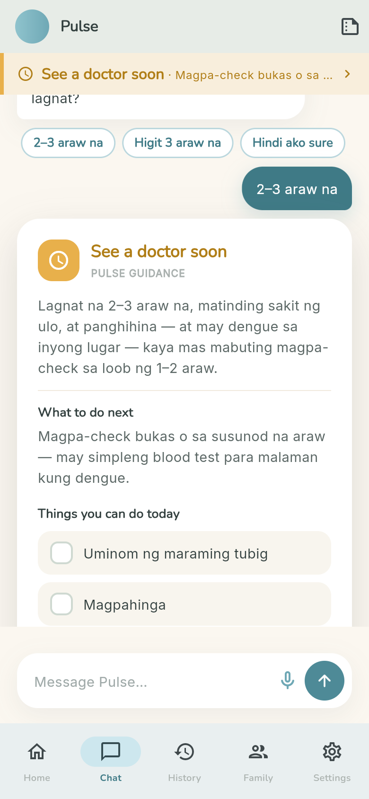
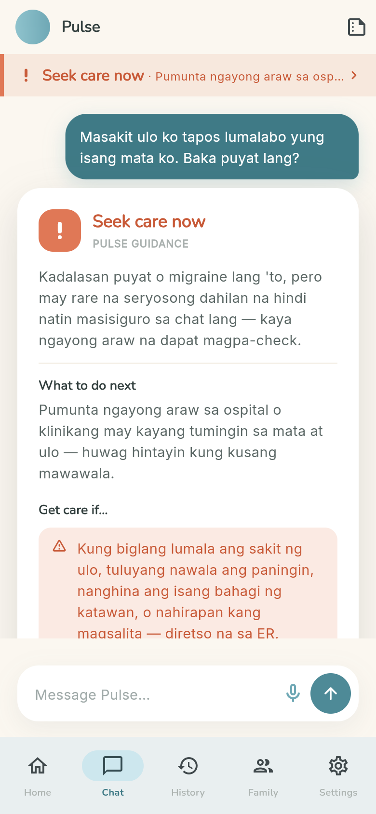
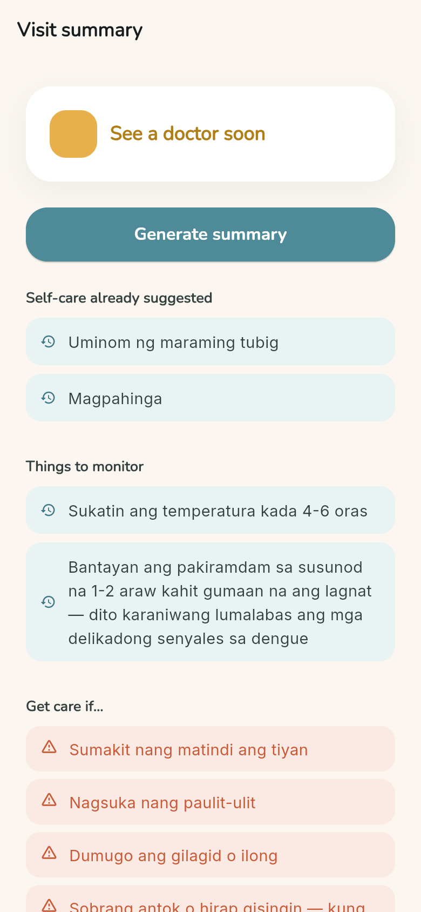
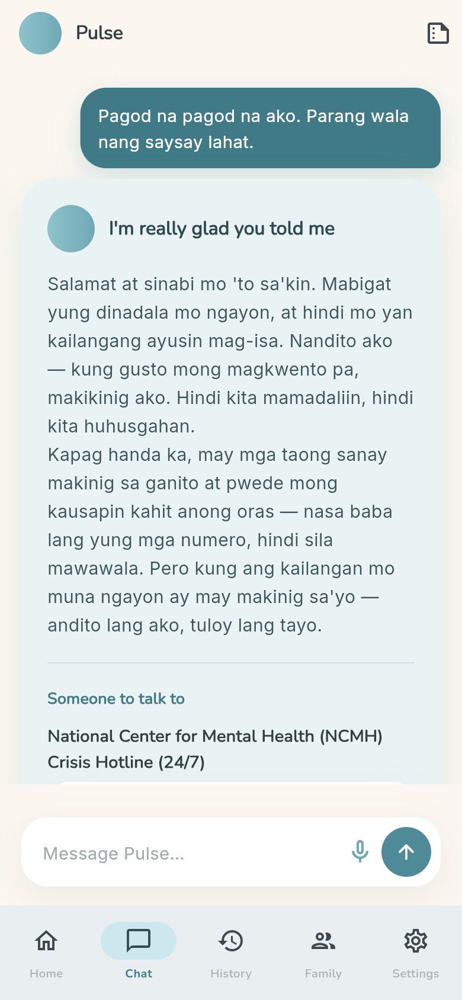
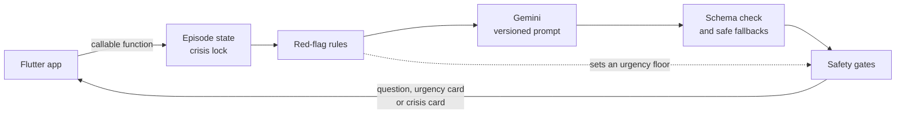

# Pulse

**An AI health companion for Filipino households.** Describe how you feel in English, Tagalog or Taglish, and Pulse tells you how urgent it is (care for it at home, see a doctor soon, or seek care now), what to do next, and what to watch for. It guides urgency. It never diagnoses.


> **Status: in development.** The chat triage and the visit summary work end to end. The Home, History, Family and Settings tabs are still placeholders. Pulse hasn't been reviewed by clinicians yet, so it isn't for real medical decisions.

| Asks one question at a time | Says how urgent it is | Escalates when it matters | A summary for your doctor |
|:-:|:-:|:-:|:-:|
|  |  |  |  |

## What it does

- **Three clear urgency levels.** Every answer ends in *Monitor at home*, *See a doctor soon* or *Seek care now*, with a next step, a self-care checklist and the warning signs that should change the plan.
- **Talks the way you talk.** Replies in the language of the message: English, Tagalog or Taglish.
- **Asks before it answers.** One short follow-up question at a time, with tap-to-answer chips.
- **Visit summary.** Turns the conversation into a one-screen brief to show a doctor: the urgency, the self-care already suggested, what to monitor, the warning signs and questions to ask.
- **Built to be calm.** Warm colors, big touch targets, and urgency colors that always come with a text label, so the meaning never depends on color alone.

## Safety is enforced in code, not left to the AI



- **Red-flag rules run on every message.** 19 groups of warning-sign phrases (in English and Tagalog) are checked before the AI's answer is shown. When one matches, the answer can't come back lower than *Seek care now*, whatever the model says.
- **Crisis mode.** Signs of self-harm switch the conversation into a crisis card with verified Philippine hotlines (NCMH, In Touch, Hopeline) and tap-to-call. It stays on for the rest of the conversation.
- **Safe fallbacks.** If Gemini fails or sends back something malformed, Pulse answers with pre-written safe responses instead of guessing.
- **Health questions only.** Off-topic requests are redirected instead of answered.
- **Crisis messages never leave the phone in a summary.** They're stripped on the device and again on the server.
- **No keys in the app.** Only the Cloud Function talks to Gemini, and Firebase App Check protects it.

<br clear="right">

## How it works



The app sends the message and conversation history to a Python Cloud Function (`assess_symptoms`). The function works out the conversation's state, runs the red-flag rules, asks Gemini with a versioned system prompt, validates the reply against a fixed schema, then applies the safety gates before anything reaches the screen. The visit summary has its own function (`generate_visit_summary`).

## Testing

- **405 Python tests** (pytest) for the rules, the safety gates, the conversation state, the reply format and the full pipeline, with Gemini mocked.
- **147 Flutter tests** for the screens, widgets and state.
- **Golden conversations:** scripted multi-turn chats that must pass before a change is merged.
- **Live evaluation suite:** 42 cases run against the real model and tracked per prompt version, kept out of CI because it costs real API calls. Results are saved in [`functions/evals/results`](functions/evals/results).

## Tech stack

| Part | Built with |
|---|---|
| App | Flutter, Dart, Riverpod, go_router, Google Fonts |
| Accounts and security | Firebase Authentication, Firebase App Check (Play Integrity) |
| Backend | Cloud Functions for Firebase in Python 3.13, Google Gemini (`gemini-3.1-flash-lite`) via `google-genai` |
| Testing | flutter_test, pytest, a custom live eval harness |

## Project docs

- [Launch vision](PULSE_LAUNCH_VISION.md): what Pulse grows into after the MVP
- [Technical plan](PULSE_TECHNICAL_PLAN.md): how each part runs on free tiers
- [Design system](PULSE_DESIGN_SYSTEM.md): colors, type, components and tone
- [Launch blockers](LAUNCH_BLOCKERS.md): what must be true before real users
- [Design specs and plans](docs/superpowers): one per feature (chat screen, conversation engine, domain gate, visit summary)

## Run it locally

You'll need a recent Flutter SDK (Dart 3.9 or newer), your own Firebase project and a Gemini API key.

```bash
flutter pub get
flutterfire configure
flutter run
```

Backend (Cloud Functions, Python):

```bash
cd functions
python -m venv venv
venv\Scripts\activate          # macOS/Linux: source venv/bin/activate
pip install -r requirements.txt
pytest
```

Put `GEMINI_API_KEY` in `functions/.env` for local runs and in Secret Manager for production. The live evaluation suite is in [`functions/evals`](functions/evals).

App tests: `flutter test`

## Screenshots

The screenshots above are the real app screens, rendered with the project's own test conversations.

---

Built by [Zaimond Lim](https://github.com/limmonjuice).
